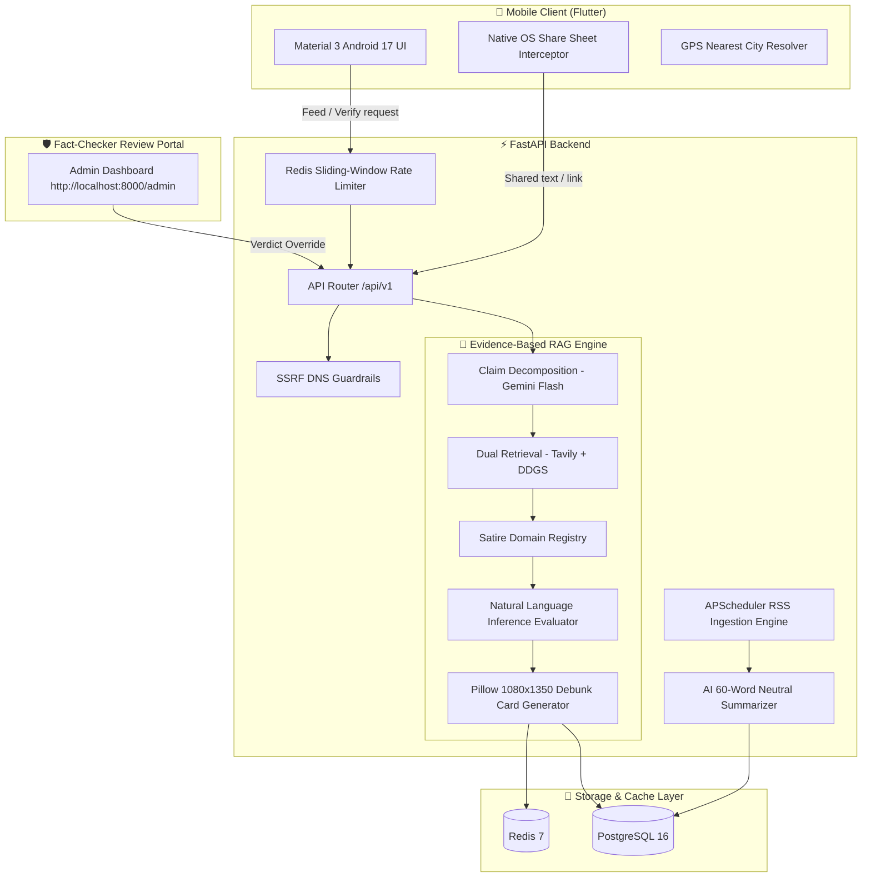

# 📰 VeriNews

> **AI-Powered Trusted Local News Feed & Real-Time Evidence-Based Misinformation Verification Platform**

[](https://fastapi.tiangolo.com)
[](https://flutter.dev)
[](https://www.postgresql.org)
[](https://redis.io)
[]()
[]()

---

## 🌟 Overview

**VeriNews** combats digital misinformation and viral rumors by pairing a **curated, 60-word neutral news reader** with a **real-time Evidence-Based RAG (Retrieval-Augmented Generation) Verification Engine**.

When users receive suspicious text forwards, news headlines, or WhatsApp rumors, they can highlight and **Share to VeriNews** directly from any app (WhatsApp, Chrome, Twitter/X) to receive:
1. An **animated 4-step investigation stepper**.
2. A **0–100% Radial Truth Score** with 5-class verdict (`TRUE`, `MISLEADING`, `FAKE`, `SATIRE`, `UNVERIFIED`).
3. Clean **3-bullet point factual explanations**.
4. An **accredited citation graph** from whitelisted news wires & fact-checkers.
5. A dynamically generated **1080×1350 branded WhatsApp Debunk Card PNG** ready for 1-tap social sharing.

---

## 🏗️ System Architecture



---

## 🗺️ Monorepo Structure

```
VeriNews/
├── backend/                  # FastAPI Application (Python 3.11)
│   ├── alembic/              # PostgreSQL schema migrations
│   ├── app/
│   │   ├── api/v1/           # API routes (health, news, verify, admin)
│   │   ├── core/             # Config, DB async engine, Redis client, SSRF, RateLimiter
│   │   ├── models/           # SQLAlchemy 2.0 ORM models (Article, Source, VerificationDossier)
│   │   ├── schemas/          # Pydantic validation schemas
│   │   └── services/         # Summarizer, Scraper, ClaimExtractor, EvidenceRetriever, DebunkCard
│   ├── static/
│   │   ├── admin.html        # Material 3 Fact-Checker Web Portal
│   │   └── debunks/          # Dynamically generated 1080x1350 PNG debunk cards
│   ├── tests/                # 20 Backend Pytest integration tests
│   └── Dockerfile            # Container configuration with TrueType DejaVu fonts
├── mobile/                   # Flutter Mobile Client (Dart 3.11 / Flutter 3.41)
│   ├── android/              # AndroidManifest.xml with native SEND Intent-filters
│   ├── lib/
│   │   ├── core/             # Material 3 Android 17 Theme, LocationService (Haversine)
│   │   ├── models/           # Article, City, Verification models
│   │   ├── services/         # ApiService, ShareIntentService
│   │   └── views/            # HomeScreen, FeedView, VerifyView, DossierScreen, Widgets
│   └── test/                 # 7 Flutter unit and widget tests
├── scripts/                  # Operations, benchmarking & deployment scripts
│   ├── start.sh              # Single-command startup (Docker + DB + Ingestion)
│   ├── stop.sh               # Graceful container shutdown
│   ├── test_all.sh           # Runs both Backend (20/20) and Flutter (7/7) tests
│   ├── benchmark_latency.py  # Subsystem latency benchmarking
│   └── benchmark_claims.py   # 20-claim verification matrix benchmark
└── docker-compose.yml        # Multi-container orchestration (DB, Redis, Backend)
```

---

## ⚡ Quick Start

### 1. Prerequisites
- **Docker** & **Docker Compose**
- **Flutter SDK 3.41+** (for mobile client)

### 2. Single-Command Startup
```bash
./scripts/start.sh
```
This automatically:
1. Launches PostgreSQL 16, Redis 7, and FastAPI.
2. Applies all Alembic migrations (`alembic upgrade head`).
3. Seeds accredited news sources (BBC, The Hindu, Times of India, NDTV).
4. Ingests fresh articles and generates 60-word AI summaries.

### 3. Service URLs
| Service | URL | Description |
|---|---|---|
| **FastAPI Swagger Docs** | [http://localhost:8000/docs](http://localhost:8000/docs) | Interactive API documentation |
| **Fact-Checker Admin Portal** | [http://localhost:8000/admin](http://localhost:8000/admin) | Human review & verdict override dashboard |
| **Backend Health Check** | [http://localhost:8000/api/v1/health](http://localhost:8000/api/v1/health) | Real-time DB & Redis health ping |
| **National News Feed** | [http://localhost:8000/api/v1/news/feed?scope=national](http://localhost:8000/api/v1/news/feed?scope=national) | 60-word neutral bullet points |
| **City News Feed (Jaipur)**| [http://localhost:8000/api/v1/news/feed?scope=city&city=jaipur](http://localhost:8000/api/v1/news/feed?scope=city&city=jaipur) | Geotagged local feed |

---

## 📱 Running the Mobile Client

```bash
cd mobile

# Get dependencies
flutter pub get

# Run unit and widget tests
flutter test

# Run app on connected device, emulator, or Linux desktop
flutter run
```

### Auto-Detected Endpoints:
- **Android Emulator:** Automatically connects to `http://10.0.2.2:8000`.
- **Linux Desktop / Web:** Automatically connects to `http://localhost:8000`.
- **Physical Android Device:** Configure local Wi-Fi IP in `mobile/lib/core/config.dart`.

---

## 🎯 6-Phase Engineering Milestone Tracker

- [x] **Phase 1: Architecture, Data Models & Backend Setup**
  * PostgreSQL 16 + Redis 7 + FastAPI in Docker Compose.
  * SQLAlchemy 2.0 async ORM + Alembic migrations.
  * 3-feed structure: Global, National, and 6 City Hubs (`delhi`, `jaipur`, `mumbai`, `bengaluru`, `chennai`, `kolkata`).
- [x] **Phase 2: Trusted News Ingestion & 60-Word AI Summarizer**
  * Asynchronous RSS ingestion via APScheduler & Trafilatura.
  * Strict 60-word neutral summarization with 3 bullets using Gemini Flash.
  * Extractive fallback for offline resiliency.
- [x] **Phase 3: Evidence-Based RAG Verification Engine**
  * Multimodal claim decomposition & targeted search query synthesis.
  * Dual-layer search: Tavily AI Search + DuckDuckGo fallback + Satire registry.
  * 5-class verdict taxonomy: `TRUE`, `MISLEADING`, `FAKE`, `SATIRE`, and `UNVERIFIED`.
  * High-contrast 1080×1350 PNG debunk card generation with Python Pillow.
- [x] **Phase 4: Flutter Cross-Platform Client & OS Share Intent**
  * Complete Material 3 Extended look (**Android 17 Google Theme style**).
  * Native OS Share-Sheet interception (`android.intent.action.SEND`).
  * Nearest City auto-detection via Haversine distance formula.
  * Animated 4-step verification stepper modal & interactive Truth Dossier.
- [x] **Phase 5: Caching, Hardening & Fact-Checker Admin Portal**
  * SSRF DNS guardrails blocking private IPs, loopback, and cloud metadata.
  * Redis sliding-window token bucket rate limiter (30 req/min per IP).
  * Web-based Fact-Checker review portal at `/admin` for human oversight, verdict overriding, and instant card regeneration.
- [x] **Phase 6: End-to-End Testing, Benchmarking & Deployment**
  * Unified `./scripts/start.sh`, `./scripts/stop.sh`, `./scripts/test_all.sh`.
  * Comprehensive 20-claim verification matrix test.
  * Subsystem latency benchmarks.

---

## 📊 Performance & Benchmarks

Measured on local environment using `python scripts/benchmark_latency.py`:

| Subsystem / Endpoint | Latency (Average) | Target | Status |
|---|---|---|---|
| **Redis Claim Cache Hit** | **2.44 ms** | $< 50\text{ ms}$ | ⚡ Ultra-Fast |
| **Redis Direct Key GET / SET** | **0.040 ms** (40 $\mu\text{s}$) | $< 1\text{ ms}$ | ⚡ Ultra-Fast |
| **City Hubs Metadata** | **0.76 ms** | $< 10\text{ ms}$ | ⚡ Ultra-Fast |
| **60-Word News Feed Delivery** | **2.74 ms – 3.88 ms** | $< 50\text{ ms}$ | ⚡ Ultra-Fast |
| **Health Check Ping** | **4.66 ms** | $< 10\text{ ms}$ | ⚡ Ultra-Fast |

---

## 🧪 Running Tests

To run the complete test suite across both backend and mobile in one command:
```bash
./scripts/test_all.sh
```

Or individually:
```bash
# Backend pytest suite (20 tests)
docker compose exec backend python -m pytest tests/ -v

# Mobile client test suite (7 tests)
cd mobile && flutter test
```

---

## 📄 License

Developed for the minor engineering project. Licensed under the MIT License.
